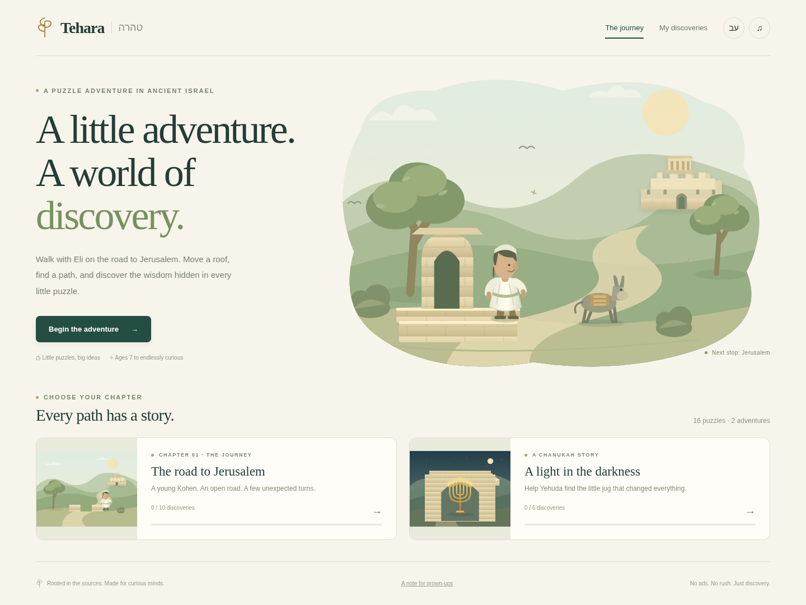

# Tehara · טהרה

An illustrated puzzle adventure about tumah and taharah. Help Eli reach Jerusalem, then join Yehuda in the search for pure oil. Ages 7+, in English and Hebrew.

## Play

```sh
python3 -m http.server 8000
# Open http://localhost:8000
```

No build, account, server API, or installation is required. All artwork is local SVG. There are no remote font, ad, or analytics requests. After the first visit, the service worker caches the new game for offline play. Source links need an internet connection.



## The rebuilt game

- **10 road puzzles:** bridge tutorial, shared roofs, moving bones, overhanging branches, steady stepping stones, blowing and choosing footsteps, lime markings, a lost grave, immersion and nightfall, and carrying terumah across a plowed-grave field.
- **6 Chanukah puzzles:** searching first, inspecting the jug, making a tight seal, vessel materials, washing before handling oil, and lighting the seven lamps of the Mikdash menorah.
- One idea at a time, immediate explanatory feedback, and retries that preserve the player's preparations.
- Touch and keyboard controls. Every interactive scene object has a corresponding button; the field's row buttons choose the next step. SVG objects also support Enter and Space.
- Source-linked discovery cards and a saved notebook. Progress, language, and sound are saved on the device in separate `tehara.v2.*` keys. The original game's progress is preserved separately because these are newly authored puzzles.
- Reduced-motion support, Hebrew layout, and sequential unlocks. Either chapter can be started independently.

Use `?unlock=all` to inspect the whole campaign, or `#level=1-6` to start an unlocked puzzle. Both flags work together. Browser console diagnostics are available at `window.__tehara.info()`.

## Original brief and implementation

This rebuild follows the core idea in [the original design](docs/GAME_DESIGN.md): a young Kohen, short environmental puzzles, real rules, and an explanation after each discovery. It reauthors the campaign rather than applying new art to the old levels. The original research and rules engine are retained.

The previous WebGL implementation is preserved at **[legacy.html](legacy.html)**, along with its renderer, level files, and tests. The new entrypoint does not load those assets.

The planned review by a rav and playtesting with children remain necessary. Automated tests establish that the game follows its coded rules; they do not independently validate the underlying halachic research. See [the rebuild notes](docs/REBUILD.md) for scope and review details.

## Tests

```sh
node --test tests/tumah.test.js tests/rebuild.test.js
# With the local server running, Playwright and Chromium installed:
node tests/e2e/rebuild.e2e.cjs
```

The browser test uses `/usr/bin/chromium` by default; set `CHROMIUM_PATH` for another binary, or `TEHARA_URL` for another local test origin. It creates screenshots in `artifacts/`.

Verified in Chromium: **82 engine/puzzle tests and 26 browser scenarios**, including all 16 solutions, error recovery, keyboard pin activation, restart cancellation, the field's bone rejection, sequential locks, persistent notebook entries, mobile and Hebrew layouts, and offline reload. Safari and Firefox have not been tested.

Legacy browser coverage remains available with `node tests/e2e/levels.e2e.js` and now points at `legacy.html`.

## Files

| File | Purpose |
| --- | --- |
| `js/rebuild/levels.js` | Bilingual puzzle definitions, state transitions, solutions, explanations, and sources |
| `js/rebuild/art.js` | Original SVG landscape, scene illustrations, characters, and interactive objects |
| `js/rebuild/app.js` | Navigation, progress, input, feedback, animation, notebook, dialogs, and sound |
| `css/rebuild.css` | Responsive visual system, focus states, and reduced-motion styling |
| `js/engine/tumah.js` | Original source-linked rules engine, used directly by the new puzzles |
| `sw.js` | Offline shell and replacement of the previous Tehara cache |
| `tools/build-preview.py` | Generates a self-contained HTML file for offline review |
