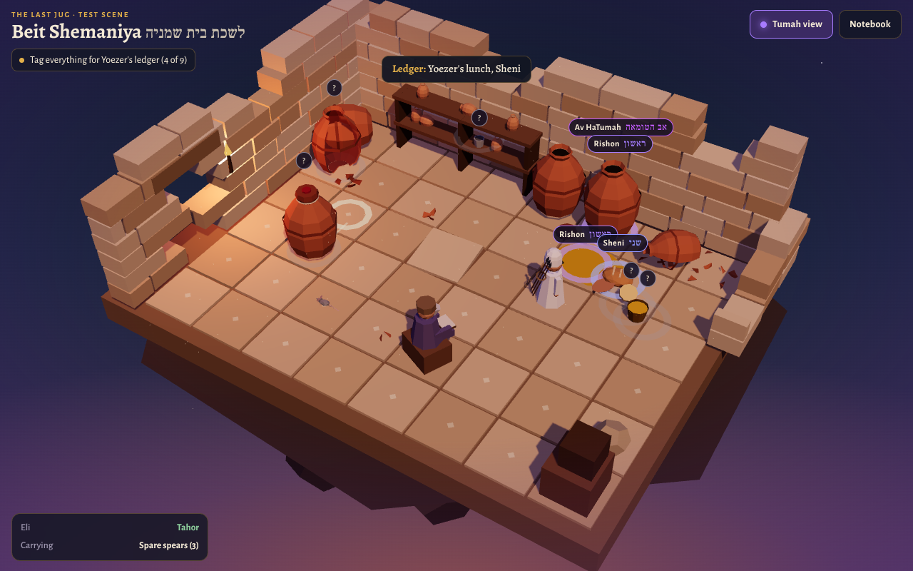

# Tehara: The Last Jug (פך השמן): design draft for the new direction

**Status:** the whole game is built and playable in English and Hebrew: [`oil/`](../oil/), 17 scenes (§5a). The current puzzles (`index.html`) and the 3D version (`legacy.html`) are untouched; once this is reviewed it becomes the main game.

**Decided so far**
- **Story:** Eli, a young Kohen, finds the one jug of pure oil in the Beit HaMikdash after the Chanukah battles and carries it to the menorah. Yehuda HaMaccabi is tamei met from the fighting, so he sends Eli.
- **First level:** Eli crosses the battlefield to reach Yehuda for his orders, without becoming tamei met.
- **Play:** point-and-click adventure. Tap where to go, tap things to use them.
- **Feel:** *Monkey Island* in attitude, not in looks: odd characters, funny conversations, puzzles that take turns you don't expect. The halacha in every joke is still correct (§2).
- **Look:** in the style of *Lara Croft GO*, kept simple enough to build (§7).
- **Audience:** 12+. Players can read real explanations, Hebrew terms and sources, and handle d'oraita / d'rabbanan distinctions.
- **Scope of halacha:** not only tumat met and ohel. The whole ladder of tumah (Av, Rishon, Sheni, Shlishi, Revi'i), how it works differently for chullin, terumah and kodesh, liquids, hands, and vessels (§4).
- **Menorah oil counts as kodesh** for the ladder (tumah reaches it down to Revi'i). This is our working assumption; it's first on the list for the rav's review.

**What carries over:** the research in [`research/`](research/) (especially file 02, the full tumah ladder) and the rules engine in `js/engine/tumah.js`, which already models these levels.

---

## 1. The story

**Act I: to Yehuda, then up to the Mikdash.** The Chashmona'im have taken back Yerushalayim. Eli stayed back with the supplies and never came near the fallen. A runner brings word: Yehuda wants him, now. Between the supply camp and Yehuda's tent lies the battlefield. Eli has to cross it without becoming tamei met; that's the first level. Yehuda is a Kohen himself, but he and most of the fighters became tamei met in the battle and need seven days and the Parah Adumah water (Bamidbar 19:11-12). Eli is one of the few Kohanim who can go into the Mikdash today. Yehuda's orders: find pure oil and light the menorah. Then Eli makes his way up through the city to the Temple Mount.

**Act II: the search.** The four chambers around the Ezrat Nashim are a mess, and each has its own odd resident. Big jugs of oil are everywhere and none of them can be used. Eli works out which of them are tamei and how (the tumah ladder), learns what the Kohen Gadol's seal looks like, and finds the one small jug, hidden away, with that seal (Shabbat 21b).

**Act III: the carry back.** The way to the Heichal runs through the damaged courtyards. Eli can carry only this one small jug. It has to stay sealed, nothing may touch the oil, and he has to stay tahor enough to pass every gate.

**Finale.** Wash at the kiyor, build the menorah the Chashmona'im actually used (iron spears, Rosh Hashanah 24b), fill seven lamps, bring fire from the outer mizbe'ach (Yoma 45b), and light. Yehuda watches from as close as he's allowed. The jug holds enough for one night; the ending plays out the eight days.

---

## 2. Tone: the *Monkey Island* feel

The aim: the player is smiling a lot of the time, is regularly surprised by where things go, and still comes out knowing the halacha cold.

### Where the comedy comes from
- **The characters, never the rules.** Every rule is presented straight and is correct. The jokes come from people: who they are, what they want, how they misunderstand things.
- **Things go sideways.** Help that makes things worse, the obvious answer that turns out wrong, a thing you were forced to carry around for no reason that turns out to be the key at the very end.
- **Dialogue choices** with three or four options: one sensible, one that teaches something, one that's just silly. The silly ones get a real (funny) answer, not a dead end.
- **Eli's voice.** Dry, a little nervous, very literal about halacha. He comments on everything you click, including things that are none of his business.
- **Real Mishnah that's already funny.** The Mikdash had some remarkable characters and customs, and the Mishnah describes them. Using the real thing keeps the comedy and the learning in the same place (cast below).

### Running gags
- **The spears.** In the first scene the quartermaster makes Eli sign for a bundle of spare spears ("regulations!"). Eli lugs them through the whole game, and everyone asks about them. In the finale the gold menorah is gone and the Chashmona'im made one from iron spears (Rosh Hashanah 24b). Eli's spears never went near the battle, so they're still tahor; the ones used in the fighting touched the fallen and are tamei like the dead themselves (Bamidbar 19:16; Rambam Tumat Met 5:3).
- **Avner's handshake.** Avner is a huge, warm-hearted fighter who is tamei met and therefore an Av HaTumah. He keeps trying to help, hug, or shake hands, and Eli keeps dodging. ("An *Av*? I'm not even married!")
- **Is that mouse alive?** A live mouse keeps turning up and Eli panics every time. A live sheretz doesn't make anything tamei; only a dead one does (Vayikra 11:31, "בְּמֹתָם"). Late in the game a dead mouse matters a lot.
- **Philo the oil merchant.** A smooth Hellenist salesman who keeps reappearing with "genuine Kohen Gadol-sealed oil, very pure, practically holy." His seals are an owl, a dolphin, and once his own face. He's how the game teaches what a real seal is, and he's the temptation in Act III.

### The cast
| Character | Who they are | Grounded in |
|---|---|---|
| **Eli** | The hero. Young Kohen, careful, talks too much | |
| **Yehuda HaMaccabi** | Tired, impressive, very direct. Tamei met, so he gives orders from a distance | Shabbat 21b; Rambam Chanukah 3:1-2 |
| **The quartermaster** | Lives for paperwork. Source of the spears | |
| **Avner** | The helpful giant. Tamei met. His help causes half of Act I's problems and solves the other half (he can do the things Eli can't, because he's already tamei) | |
| **Philo** | The oil merchant. Decoy seals, bad deals | |
| **The sleeping Levi guard** | Guarding the gate, fast asleep. The officer of the Temple Mount does rounds with torches, and a guard found asleep could have his clothes set on fire. Waking him before the officer arrives is a puzzle | Mishnah Middot 1:2 |
| **The nazir** | His nezirut ends today. He's in the Nazirites' chamber cooking his shelamim, about to shave and put his hair under the pot, and he is very attached to his hair | Mishnah Middot 2:5 |
| **The wood inspector** | A Kohen with a blemish who can't serve at the mizbe'ach, so he checks every log for worms, and takes it extremely seriously. The joke is his perfectionism, never the blemish | Mishnah Middot 2:5 |
| **Yochanan of the seals** | Runs the token-seal system. His tokens (Egel, Zachar, Gedi, Choteh) look like seals and aren't the right kind; but he knows exactly what the Kohen Gadol's seal looks like | Mishnah Shekalim 5:1, 5:3 |
| **Gevini the herald** | Has the loudest voice in the Mikdash. Useful for waking people | Mishnah Shekalim 5:1 |

**Creative license:** Yochanan and Gevini are named in the Mishnah as officials of the Second Temple, but from a later generation. We borrow them on purpose, and the notebook says so. Avner, Philo, the nazir, the wood inspector and the quartermaster are invented.

### Pilpul duels (our version of insult sword-fighting)
In *Monkey Island* you win sword fights by learning insults and their comebacks. Here, a few characters (the Levi guard, Yochanan, Philo) challenge Eli with halachic claims, and he answers with rules he's picked up along the way. Wrong answers get funny replies and let you try again; the right ones win the argument. Examples:

| They say | The right comeback | Source |
|---|---|---|
| "You touched a jug that touched a dead mouse. You're tamei!" | "That jug is a Rishon. A Rishon can't make a person tamei." | Rambam Tumat Met 5:7-8 |
| "That jug sat under the same roof as a met all week!" | "It's clay and tightly sealed. The seal protects what's inside." | Bamidbar 19:15 |
| "Your hands are clean, why wash before touching the oil?" | "Unwashed hands count as a Sheni, and a Sheni makes a liquid a Rishon." | Mishnah Parah 8:7 |
| "Look, my seal is perfect. Buy it!" | "A perfect seal on a jug that was moved isn't good enough." | Tosafot Shabbat 21b |

Each comeback is unlocked by solving the scene where you learn it, and lives in the notebook.

### Lines we don't cross
- **The fallen are never funny.** Every scene with a met is quiet and respectful. The comedy comes from the living people around it.
- **The avodah is never a joke.** Lighting the menorah is played straight.
- **The halacha is never wrong for the sake of a joke.** If a character says something wrong, the game makes clear it's wrong.

---

## 3. Gameplay: point-and-click

*Lara Croft GO* is itself a tap-to-move game: each level is a small diorama with a few spots you can walk to, and you tap the next spot or an object. That's a natural fit for point-and-click, and it keeps the game turn-based: nothing moves until the player acts, so there's time to read and think.

### What the player does
| Action | How |
|---|---|
| **Walk** | Tap a spot. Eli walks there along the path. If the step would make him tamei, he stops and says why ("That awning is the same roof as the fallen soldier"). |
| **Look** | Tap any object for Eli's comment on it. Look closer opens a close-up (seals, labels, marks on the floor). |
| **Use** | Tap an object to push, pull, open, close, lower, raise, light, pour. |
| **Talk** | Dialogue with choices, including pilpul duels. |
| **Inventory** | The spears, a wedge stone, a rope, a lamp, a stone cup, the jug once found. Drag an item onto something or onto another item. Some combinations are useful, some are just funny. |
| **Tag** (Act II on) | Mark any object with its status: Tahor, Av, Rishon, Sheni, Shlishi, Revi'i, Pasul. This is how the tumah-ladder puzzles work (§4). |
| **Undo / restart** | Always available. No lives, no timers. |

### Not always straightforward
- **Act II is open.** The four chambers can be visited in any order, and the puzzles depend on each other: the nazir has fire, the wood inspector has a crowbar, Yochanan knows the seal. As in *Monkey Island*, you'll often have to leave a puzzle and come back with something from somewhere else.
- **Expectations get turned around.** The first sealed jug you find is Philo's. The first "perfect" jug in the storeroom was moved. The kiyor's water is there but has become unfit overnight. The menorah you came to light isn't there.

### Always on screen
- **Eli's status:** tahor / washed hands / unwashed hands (Sheni d'rabbanan) / tamei (and which kind, with what it would take to become tahor again).
- **The jug:** sealed ✓, not moved by anyone else ✓, nothing added ✓, still in Eli's care ✓.
- **Tumah view** (toggle): shades the area under the same roof as a met, and shows each object's tag once the player has worked it out.

### What the big jugs are for
- **Act II:** they're the evidence. Each one became tamei in a different way, and working out how is the puzzle.
- **Act III:** the temptation. "The little jug won't last eight days. Top it up from this big one?" Opening the seal or mixing in tamei oil makes the pure oil tamei, so the right answer is to leave it. That sets up the miracle.
- **Obstacles:** a spilled jug leaves a floor of tamei oil that you can't let touch the lamp or the wick.

---

## 4. The tumah ladder: making Av, Rishon, Sheni and the rest part of the game

### Why it fits this story so well
The oil for the menorah is set aside for the Mikdash, so we treat it as kodesh. For kodesh, tumah goes **four steps down**: even a Revi'i disqualifies it. Oil is also a **liquid**, and liquids are the most sensitive of all: anything that makes terumah unfit makes a liquid a **Rishon** (Mishnah Parah 8:7). Even unwashed hands are enough. So the oil is about the easiest thing in the world to ruin. That's why one sealed, untouched jug mattered so much, and it's why Eli has to understand the whole ladder, not only tumat met.

### What the player learns, act by act

**1. The kinds of Av (Act I).** Not all sources of tumah are equal.
- A **met** is the strongest (*avi avot hatumah*). It spreads by touching, by carrying, and by being under the same roof.
- **A vessel that touched a met** (a sword from the battle, a shield, a cloak) is tamei just like the met: whoever touches it becomes tamei for seven days (Bamidbar 19:16, "חֲלַל חֶרֶב"; Rambam Tumat Met 5:3).
- A **sheretz** (a dead mouse) is an Av that spreads only by touching, not by carrying and not by roof. A Kohen is allowed to become tamei from one, but then he couldn't enter the Mikdash today.
- A **tamei met person** (Yehuda, Avner) is an Av too. If one of them takes Eli's hand, Eli becomes tamei until evening, after immersing (a Rishon). That's enough to keep him out of the Ezrat Nashim today.
- **Rule the game teaches:** only an Av makes a *person* or a *vessel* tamei. A Rishon can't. (Mishnah Kelim 1:1-4; Rambam Tumat Met 5:7-8)

**2. Counting the steps (Act II).** Whatever touches an Av becomes Rishon; whatever touches a Rishon becomes Sheni, and so on (Rambam Tumat Met 5:8). How far it goes depends on what the thing is:

| | Rishon | Sheni | Shlishi | Revi'i |
|---|---|---|---|---|
| **Chullin** (ordinary food) | tamei | pasul, stops here | – | – |
| **Terumah** | tamei | tamei | pasul, stops here | – |
| **Kodesh** (the Mikdash's things, the menorah oil) | tamei | tamei | tamei | pasul, stops here |

(Rambam She'ar Avot HaTumot 11:2-4; the Shlishi and Revi'i of food are d'rabbanan.)

**3. Liquids jump back to the top (Act II).** A liquid that touches a Rishon *or a Sheni* becomes a Rishon, not one step further down (Mishnah Parah 8:7; Rambam She'ar Avot HaTumot 7). The one exception: a tevul yom doesn't do this.

**4. Hands (Act II and the finale).** By rabbinic law, hands that haven't been washed are treated as a Sheni (Rambam She'ar Avot HaTumot 8:8). They disqualify terumah and kodesh and make liquids tamei. For kodesh, the hands have to be immersed, not just washed (Mishnah Chagigah 2:5). And in the Mikdash a Kohen washes hands and feet from the kiyor before he serves (Shemot 30:19-21).

**5. Vessels (Act II).** Different materials follow different rules:
- **Clay** becomes tamei only from the inside, through its airspace. Touching the outside does nothing (Vayikra 11:33). That's why the sealed clay jug survived.
- **Metal** becomes tamei from any touch.
- **Stone** never becomes tamei at all. So in a wrecked storeroom, the stone cup is the one vessel Eli can be sure of.
- **A tight seal** (*tzamid patil*) protects a clay vessel's contents even under the same roof as a met (Bamidbar 19:15).

**6. People's levels and the gates (Act III).** The courtyards are the test of everything above (Mishnah Kelim 1:5-9):

| Gate | Who is stopped there |
|---|---|
| Cheil | anyone tamei met |
| Ezrat Nashim | a *tevul yom* (immersed, but the sun hasn't set) |
| Ezrat Yisrael | a *mechusar kippurim* (still needs to bring his korban) |
| Ezrat Kohanim | anyone who isn't a Kohen, except to bring a korban |
| Heichal | a Kohen who hasn't washed hands and feet |

### The notebook
Every rule Eli works out goes into a notebook ("Sefer Taharah"), along with the pilpul comebacks. By the end it holds the full ladder chart above, the gates, and a source page for each rule with Hebrew text and a Sefaria link. Each page also shows which parts are d'oraita and which are d'rabbanan, and where the game takes creative license.

---

## 5. Level outline (third pass, 19 scenes)

### Act I: to Yehuda, then up to the Mikdash (kinds of Av; touching, carrying, roof)
| # | Scene | What happens | Source |
|---|---|---|---|
| 1 | **The Supply Camp** | Tutorial: walk, look, use, talk. The quartermaster makes Eli sign for the spears. A runner: Yehuda wants you | |
| 2 | **Across the Battlefield** | The first real level. Eli has to reach Yehuda's tent. The fallen lie covered in the field; a torn tent and a cart's canopy are roofs that would put him under the same roof as a met; a dropped sword is as tamei as the met it touched. Find a way through without touching, carrying or being under the same roof as any of it | Rambam Tumat Met 1:10, 5:3, 12:1; Bamidbar 19:16 |
| 3 | **Yehuda's Tent** | The orders. Yehuda explains why he can't go himself, and talks to Eli from a careful distance. Avner is assigned to "help" | Bamidbar 19:11-12; Shabbat 21b |
| 4 | **The Market Awning** | Avner helpfully stretches a tarp over Eli's path for shade, and joins it to the awning over a fallen fighter: now it's all one roof. Talk him into taking it down without touching him | Rambam Tumat Met 12:1 |
| 5 | **Bones in the Rubble** | A bone the size of a barley grain blocks the alley. It spreads tumah only by touching or moving it, not by roof. Eli can't move it, but Avner is already tamei met and can take it for burial | Rambam Tumat Met 1:7, 2:10 |
| 6 | **Philo's Stall** | First meeting with Philo and his "Kohen Gadol" oil. The live mouse makes its first appearance | Vayikra 11:31 |
| 7 | **The Cheil Gate** | The Levi guard is asleep and the officer's torches are coming. Get Gevini to shout him awake, then win the first pilpul duel to get in. Avner (and Yehuda's runner) stop here | Mishnah Middot 1:2; Mishnah Kelim 1:8 |

### Act II: the search (the ladder; open order)
The Ezrat Nashim is a hub with four corner chambers (Mishnah Middot 2:5). Scenes 9-13 can be played in any order, and items from one solve another.

| # | Scene | What happens | Source |
|---|---|---|---|
| 8 | **The Ezrat Nashim** | The hub. A warm-up ladder puzzle: one dead mouse, one bowl, one loaf, count the steps | Rambam Tumat Met 5:8 |
| 9 | **The Nazir's Chamber** | The nazir has the only fire around but won't let go of it (or his hair) until his korban is done. Help him finish so he'll light Eli's lamp for the dark storeroom | Mishnah Middot 2:5 |
| 10 | **The Wood Chamber** | The wood inspector has the crowbar Eli needs. He'll lend it in exchange for a log with no worms. There's exactly one | Mishnah Middot 2:5 |
| 11 | **Beit Shemaniya** | The oil chamber, full of big jugs. A dead mouse fell into one: its airspace made the jug and the oil tamei. Then the detective scene: a ladle went from that jug into another, and a loaf touched the spill. Tag every object with its step on the ladder. The oil keeps jumping back to Rishon | Mishnah Middot 2:5; Vayikra 11:33; Mishnah Parah 8:7 |
| 12 | **Three Shelves** | In the Lechem HaPanim bakers' chamber: one touch, three results. Chullin stops at Sheni, terumah at Shlishi, kodesh goes to Revi'i | Mishnah Middot 1:6; Rambam She'ar Avot HaTumot 11:2-4 |
| 13 | **Yochanan of the Seals** | Yochanan will only show the Kohen Gadol's seal after a pilpul duel. Learn the difference between his token seals and a real seal | Mishnah Shekalim 5:1, 5:3 |
| 14 | **The Dark Storeroom** | With the lamp, the crowbar and the seal: clay, metal and stone vessels (only the stone cup is certain); broken seals, a redone seal, a perfect seal next to a fresh dust ring (moved). Under a loose floor tile, the small jug with the Kohen Gadol's seal | Vayikra 11:33; Mishnah Kelim 10:1; Shabbat 21b; Rashi; Tosafot |

### Act III: the carry back (everything combined)
| # | Scene | What happens | Source |
|---|---|---|---|
| 15 | **Sealed Is Safe** | The only route passes a room with a met. The seal would protect the oil, but Eli still mustn't go under that roof. Close a shutter; one tefach matters | Bamidbar 19:15; Rambam Tumat Met 14:1 |
| 16 | **The Door That Stands by Itself** | A door held shut by a person doesn't block tumah; a door wedged with a stone does | Rambam Tumat Met 18:3 |
| 17 | **Philo's Last Offer** | Philo is back with a huge jug: "Top it up! Eight days!" Leave the seal alone, and win the last duel | Mishnah Parah 8:7; Rambam Tumat Okhalin 1:2 |
| 18 | **The Gates** | Each courtyard checks Eli and the jug | Mishnah Kelim 1:5-9 |

### Finale
| # | Scene | What happens | Source |
|---|---|---|---|
| 19 | **Kiyor, Spears and Lamps** | The kiyor's water stood overnight and became unfit; refill it before Eli can wash hands and feet. The gold menorah is gone, so the spears finally earn their keep. Fill seven lamps with half a log each, bring fire from the outer mizbe'ach, and light. Then the eight days | Mishnah Yoma 3:10; Shemot 30:19-21; Rosh Hashanah 24b (= Menachot 28b, Avodah Zarah 43a); Mishnah Menachot 9:3; Yoma 45b; Shabbat 21b |

**Why search at all?** If tumah is allowed for the whole community (*tumah hutra b'tzibur*), why not use the tamei oil? The Rambam rules it's only *pushed aside* (*dechuyah*), so you have to look for pure oil first (Yoma 6b; Rambam Bi'at HaMikdash 4:15). The notebook also gives the other answers (Pnei Yehoshua, Chatam Sofer; research file 03, §5).

**Why eight days?** Night by night the lamps keep burning while olives are pressed for new pure oil (Rambam Chanukah 3:2). The notebook gives the explanations: the olives were four days away (Ran, Maharsha), or everyone was tamei met and needed seven days.

---

## 5a. What's built (17 scenes)

The plan in §5 was trimmed to 17 scenes so every one has a real puzzle. Changes from the plan: Yochanan of the seals stands in the Ezrat Nashim instead of having his own scene; the "three shelves" lesson moved into the courtyard warm-up (a baker's apprentice with unwashed hands, a terumah loaf and a cup of wine); the wood inspector gives Eli the nazir's razor and a wedge stone; and the spears, signed for as three, turn out to be seven.

| # | Scene | The puzzle | Source |
|---|---|---|---|
| 1 | The Supply Camp | Tutorial; sign for the spears | |
| 2 | Across the Battlefield | The only bridge is under a tent over one of the fallen; build another with a plank. The sword is "like the met" | Bamidbar 19:14, 16; Rambam Tumat Met 5:3, 12:1 |
| 3 | Yehuda's Tent | Yehuda keeps his distance; *dechuyah* vs *hutrah*; don't shake Avner's hand | Yoma 6b; Rambam Bi'at HaMikdash 4:15; Mishnah Kelim 1:1 |
| 4 | The Market Awning | Avner's tarp joins the awning over a fallen fighter into one roof | Rambam Tumat Met 12:1 |
| 5 | Bones in the Rubble | Pushing the crate would move a barley-sized bone; Avner buries it | Rambam Tumat Met 2:9-10 |
| 6 | Philo's Stall | Owl seals; a live mouse | Shabbat 21b with Rashi; Vayikra 11:31 |
| 7 | The Cheil Gate | Wake the sleeping guard with Gevini's call; a duel about tumat met | Mishnah Middot 1:2; Yoma 20b; Mishnah Kelim 1:8 |
| 8 | The Ezrat Nashim (hub) | Unwashed hands: chullin stays tahor, terumah is Shlishi, wine is Rishon | Rambam She'ar Avot HaTumot 8:8, 11:2-3; Mishnah Parah 8:7 |
| 9 | The Nazirites' Chamber | Return the razor; the hair goes under the pot; the lamp is lit | Mishnah Nazir 6:8; Middot 2:5 |
| 10 | The Wood Chamber | Find the log with no worms | Mishnah Middot 2:5 |
| 11 | Beit Shemaniya | The tumah ladder, the seal, the hidden jug, the duel | (the original test scene) |
| 12 | Sealed Is Safe | An open window of a tefach brings tumah into the passage room; close the shutter | Rambam Tumat Met 14:1; Bamidbar 19:15 |
| 13 | The Door That Stands by Itself | A Levi holding the door shut doesn't count; a wedged stone does | Mishnah Oholot 6:1 |
| 14 | Philo's Last Offer | Duel: seals, "half and half", *dechuyah* | Rambam Tumat Okhalin 4:2 |
| 15 | The Gates | Who may enter each courtyard | Mishnah Kelim 1:8-9 |
| 16 | The Kiyor | Water that stood overnight; Ben Katin's machine; wash; fire from the outer mizbe'ach | Mishnah Yoma 3:10; Shemot 30:19-21; Yoma 45b |
| 17 | Spears and Lamps | Build the menorah from iron spears (straight branches, as the Rambam drew it); half a log per lamp; eight nights | Rosh Hashanah 24b; Mishnah Menachot 9:3; Shabbat 21b; Rambam Chanukah 3:2 |

**How it's put together.** The sources are in `oil/src/` (engine, one file per act); `python3 tools/build-oil.py` concatenates them into `oil/game.js`, and `python3 tools/build-oil.py OUT.html` also writes a single shareable page. Progress, the notebook and the language choice are saved on the device; the title screen has New game, Continue and Chapters.

**Testing.** `tests/e2e/oil.e2e.cjs` starts a new game from the title screen and plays every scene through the real interface, wrong answers included, until it is back at the title screen: `node tests/e2e/oil.e2e.cjs en` or `he`, with optional width and height.

## 6. Handling the war

- No fighting on screen. The game starts after the battle.
- The fallen are covered, still shapes, shown with respect. The battlefield level is quiet: no jokes in it except from Eli's own nerves. The text says that burying the fallen is a mitzvah, and that becoming tamei for it is good; Eli just can't today because he's needed in the Mikdash.
- Left out: the rabbinic decree treating gentiles like zavim (the deeper reason a moved jug didn't count) and the idols the Greeks set up. The notebook can mention that "there were further rabbinic reasons" without the details. The defiled altar stones (Middot 1:6) can be a background detail.

---

## 7. Graphics: a *Lara Croft GO* look without a huge art budget

What makes that look work isn't detail. It's a few strict rules:
- **Low-poly, flat-shaded shapes.** Big simple forms, no textures, clean silhouettes.
- **A small palette per scene** (5–7 colors), with one warm key light and cool shadows.
- **One fixed camera per scene,** high and at an angle, so every scene reads like a small diorama floating in fog or darkness.
- **Very few objects,** each of them important.

That's a style that suits code, because it's about simple shapes and good lighting, not hand-painted detail. The plan:
1. **three.js, one fixed camera per scene.** No free camera to build or test.
2. **Simple architecture built in code from a small kit:** floor tiles, steps, walls, columns, arches, gates, awnings, crates, jugs, the menorah. These are all simple shapes, which is what low-poly is good at.
3. **Free (CC0) low-poly asset packs for the rest,** such as Kenney, Quaternius or KayKit, recolored to the palette. Licenses to be checked before anything goes in.
4. **Characters** are the hardest part, and with this cast there are more of them. Start from a CC0 low-poly character base and vary clothes, beards, size and color, rather than modeling each from scratch. Comedy lives in the faces and poses, so each character gets a few strong poses and expressions instead of full animation.
5. **Close-ups and conversation portraits** as flat 2D illustrations over the scene, which are easier to make sharp and expressive than 3D.

**Why this should go better than the last 3D attempt:** last time there were no style rules or references, lots of small objects, and a moving camera. This time the reference is fixed (*Lara Croft GO*), the rules above are fixed, and we judge one room before building more.

**Test scene (built):** [`oil/`](../oil/) is a playable version of scene 11 with a storekeeper, Yoezer the Levi, standing in for the full Act II cast. Run `python3 -m http.server` from the repo root and open `/oil/`; `python3 tools/build-oil-artifact.py OUT.html` bundles it into one shareable page. 

**Original plan for the test scene.** Beit Shemaniya (scene 11): the oil chamber with the big jugs, Eli, tap to walk, tap a jug for Eli's comment, a short exchange with one character, and the tumah view. If the look isn't right, we change the style before any more scenes exist. If code-built art still isn't good enough, the fallback is to keep the same gameplay and swap in purchased or generated art.

---

## 8. Build plan

1. **Test scene** (above), to settle the look and the tone of the writing.
2. **Engine:** scenes from data files, walk spots and paths, objects with actions, dialogue trees and duels, inventory and combining, tagging, undo, and the status panel, all running on `js/engine/tumah.js`.
3. **Act I** playable end to end.
4. **Acts II–III and the finale.**
5. English and Hebrew text, the notebook with Sefaria links, saved progress on the device.
6. Tests for every scene's solution and every rule. A rav reviews the halacha before release.

---

## 9. For the rav's review

1. **Is menorah oil "kodesh" for the ladder (tumah down to Revi'i)?** The game assumes yes.
2. **Weapons from the battle:** a sword that touched a met is tamei like the met (Rambam Tumat Met 5:3). Is the game's simplified version of that rule right?
3. **The helping hand:** Avner (tamei met) can carry a bone for burial and move things for Eli, as long as they don't touch. Anything we're missing?
4. **The fire from the outer mizbe'ach** in the finale, given the original altar had been defiled.
5. **Creative license:** the borrowed Second Temple officials (Yochanan, Gevini), and Philo's decoy seals.
